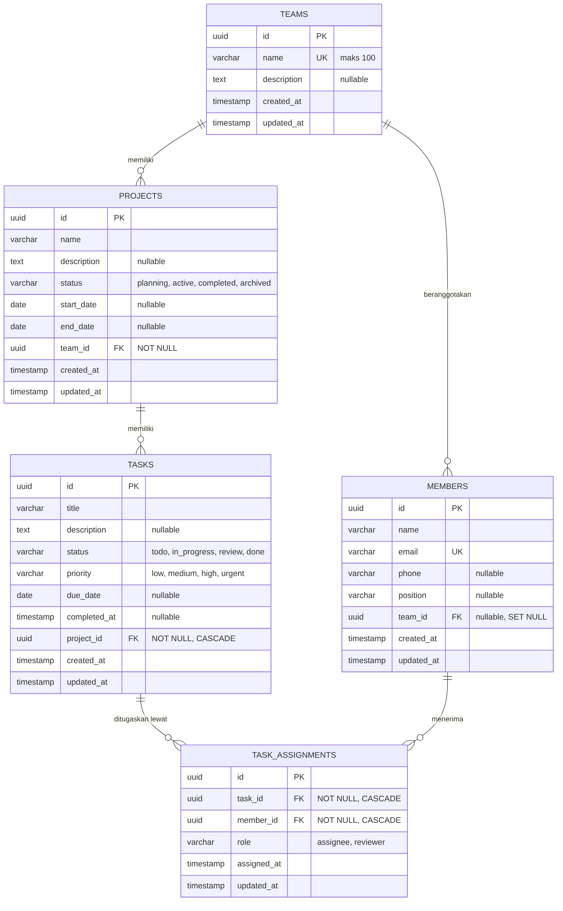

# ERD (Entity Relationship Diagram) - Task Management System

Gambar: [`erd.png`](./erd.png) (sumber diagram: [`erd.mmd`](./erd.mmd))

## Relasi antartabel

| Relasi | Tipe | Foreign key | Perilaku saat induk dihapus |
|---|---|---|---|
| Team → Projects | One-to-Many | `projects.team_id` (NOT NULL) | Ditolak (409) bila tim masih punya proyek |
| Team → Members | One-to-Many | `members.team_id` (nullable) | `SET NULL` (anggota tetap ada tanpa tim) |
| Project → Tasks | One-to-Many | `tasks.project_id` (NOT NULL) | `CASCADE` (tugas ikut terhapus) |
| Task ↔ Member | Many-to-Many lewat `task_assignments` | `task_assignments.task_id`, `task_assignments.member_id` | `CASCADE` (penugasan ikut terhapus) |

`task_assignments` memiliki constraint `UNIQUE (task_id, member_id)` sehingga satu anggota hanya dapat ditugaskan satu kali pada tugas yang sama.

## Aturan bisnis

1. Nama tim dan email anggota harus unik.
2. Tim yang masih memiliki proyek tidak dapat dihapus.
3. `end_date` proyek tidak boleh lebih awal dari `start_date`.
4. Proyek berstatus `completed` atau `archived` tidak dapat menerima tugas baru.
5. Tenggat waktu (`due_date`) tugas tidak boleh sebelum hari ini.
6. Alur status tugas: `todo → in_progress → review → done`. Boleh mundur satu langkah (`in_progress → todo`, `review → in_progress`) dan tugas `done` dapat dibuka kembali (`done → in_progress`). Lompat status ditolak.
7. Tugas tidak dapat dipindah dari `todo` ke `in_progress` bila belum ditugaskan ke minimal satu anggota.
8. `completed_at` terisi otomatis saat tugas menjadi `done` dan dikosongkan bila dibuka kembali.
9. Penugasan hanya untuk anggota yang berasal dari tim pemilik proyek, tidak boleh ganda, dan tidak boleh pada tugas yang sudah `done`.
10. Satu request penugasan dapat berisi beberapa anggota (`memberIds`) dan diproses dalam satu transaksi.
11. Anggota yang masih memiliki penugasan pada tugas yang belum `done` tidak dapat dihapus, dipindah ke tim lain, atau dikeluarkan dari tim (409). Ini menjaga agar aturan nomor 9 tidak terlanggar oleh perubahan tim setelah penugasan dibuat.
12. Penugasan terakhir pada tugas berstatus `in_progress` atau `review` tidak dapat dilepas (400), agar aturan nomor 7 tetap berlaku selama tugas dikerjakan.
