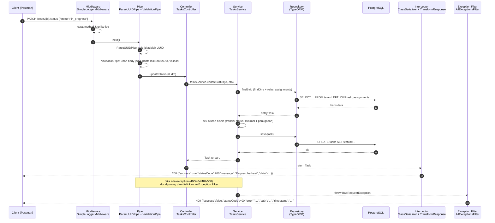

# Alur Request: Client → Controller → Service → Database

Dokumen ini menjelaskan perjalanan satu request di aplikasi ini. Contoh utama: **`PATCH /tasks/:id/status`**, karena melewati hampir semua komponen (validasi, aturan bisnis, database, dan penanganan error).

## 1. Gambaran umum



## 2. Urutan komponen NestJS

Urutan ini adalah urutan bawaan NestJS (request lifecycle) dan sesuai konfigurasi di `src/app.module.ts` dan `src/main.ts`.

| # | Tahap | Komponen di project ini | Tugas |
|---|---|---|---|
| 1 | Middleware | `SimpleLoggerMiddleware` (didaftarkan di `AppModule.configure`) | Mencatat method dan URL setiap request masuk |
| 2 | Guard | Tidak digunakan (belum ada autentikasi) | - |
| 3 | Interceptor (sebelum handler) | `TransformResponseInterceptor`, `ClassSerializerInterceptor` | Hanya membungkus aliran, pengolahan dilakukan setelah handler selesai |
| 4 | Pipe | `ParseUUIDPipe` (per parameter), `ValidationPipe` (global) | Memvalidasi `:id` dan body/query terhadap aturan `class-validator` di DTO; `whitelist` dan `forbidNonWhitelisted` menolak field yang tidak dikenal; `transform` mengubah JSON menjadi instance DTO |
| 5 | Controller | `TasksController`, dst. | Memetakan route ke method dan mendelegasikan ke service, **tanpa logika bisnis** |
| 6 | Service (Provider) | `TasksService`, dst. | Aturan bisnis, koordinasi beberapa repository, melempar exception HTTP |
| 7 | Repository | `Repository<Task>` hasil `@InjectRepository` | Query database lewat TypeORM |
| 8 | Database | PostgreSQL (docker-compose) | Menyimpan data dan menegakkan constraint (FK, UNIQUE, CASCADE) |
| 9 | Interceptor (sesudah handler) | `ClassSerializerInterceptor`, lalu `TransformResponseInterceptor` | Menerapkan serialisasi entity, lalu membungkus ke format `{success, statusCode, message, data}` |
| 10 | Exception Filter | `AllExceptionsFilter` (global) | Bila ada exception di tahap mana pun, diubah menjadi format error seragam |

## 3. Dependency Injection

Controller tidak membuat service sendiri. NestJS yang membuat dan menyuntikkannya lewat constructor.

```
AppModule
 ├─ TypeOrmModule.forRootAsync(...)   → membuat koneksi DataSource ke PostgreSQL
 └─ TasksModule
     ├─ imports:   TypeOrmModule.forFeature([Task, Project])  → menyediakan Repository<Task>, Repository<Project>
     ├─ providers: TasksService   ← menerima kedua repository via @InjectRepository
     └─ controllers: TasksController ← menerima TasksService via constructor
```

- `TasksController` bergantung pada `TasksService`, bukan pada database.
- `TasksService` bergantung pada `Repository<Task>` dan `Repository<Project>`, bukan pada koneksi database langsung.
- Karena itu, pada unit test (`*.service.spec.ts`) repository cukup diganti mock lewat `Test.createTestingModule`, tanpa database sungguhan.

## 4. Contoh alur lain

### 4.1 `POST /task-assignments` (menugaskan beberapa anggota)

1. Middleware mencatat request.
2. `ValidationPipe` memvalidasi `CreateTaskAssignmentDto` (`taskId` UUID, `memberIds` array UUID, `role` opsional).
3. `TaskAssignmentsController.create` memanggil `TaskAssignmentsService.create`.
4. Service memeriksa berurutan: tugas ada (404) → tugas belum `done` (400) → semua member ada (404) → semua member berasal dari tim pemilik proyek (400) → belum pernah ditugaskan (409).
5. Bila semua lolos, penyimpanan dilakukan dalam **satu transaksi** (`DataSource.transaction`), sehingga semua anggota tersimpan atau tidak sama sekali.
6. Hasil dikembalikan dengan relasi `task` dan `member`, dibungkus interceptor menjadi `201`.

### 4.2 `GET /tasks/:id` (detail tugas beserta anggota)

1. `ParseUUIDPipe` memastikan `:id` valid (bila tidak, `400`).
2. `TasksService.findById` memanggil `findOne` dengan `relations: { project: { team: true }, assignments: { member: true } }`.
3. TypeORM membuat query JOIN ke `projects`, `teams`, `task_assignments`, dan `members`.
4. Bila tidak ditemukan, `NotFoundException` dilempar dan `AllExceptionsFilter` mengubahnya menjadi respons `404`.
5. Bila ditemukan, respons berisi detail tugas dan daftar anggota yang ditugaskan.

## 5. Contoh respons

Sukses:

```json
{ "success": true, "statusCode": 200, "message": "Request berhasil", "data": { "id": "...", "status": "in_progress" } }
```

Gagal (aturan bisnis dilanggar):

```json
{
  "success": false,
  "statusCode": 400,
  "timestamp": "2026-11-08T10:00:00.000Z",
  "path": "/tasks/<id>/status",
  "method": "PATCH",
  "error": "Tugas harus ditugaskan ke minimal satu anggota sebelum dikerjakan"
}
```
